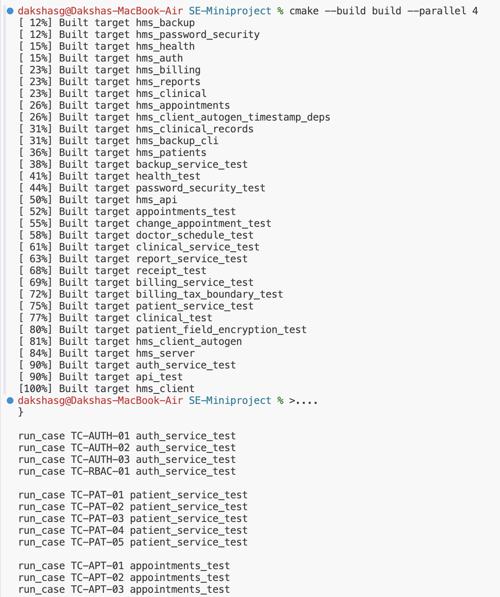
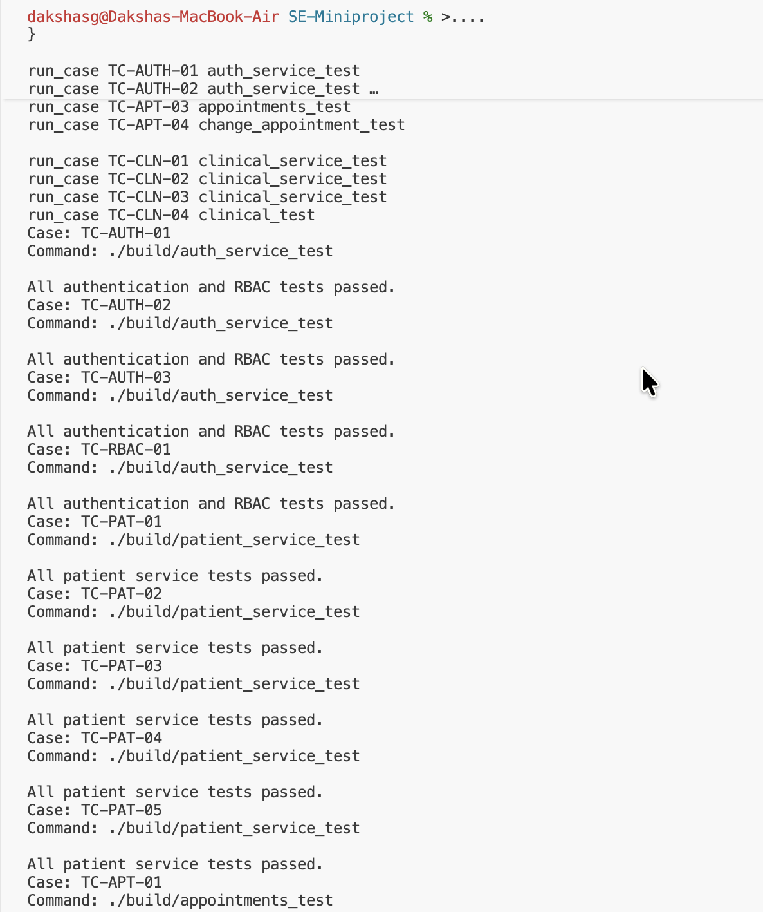
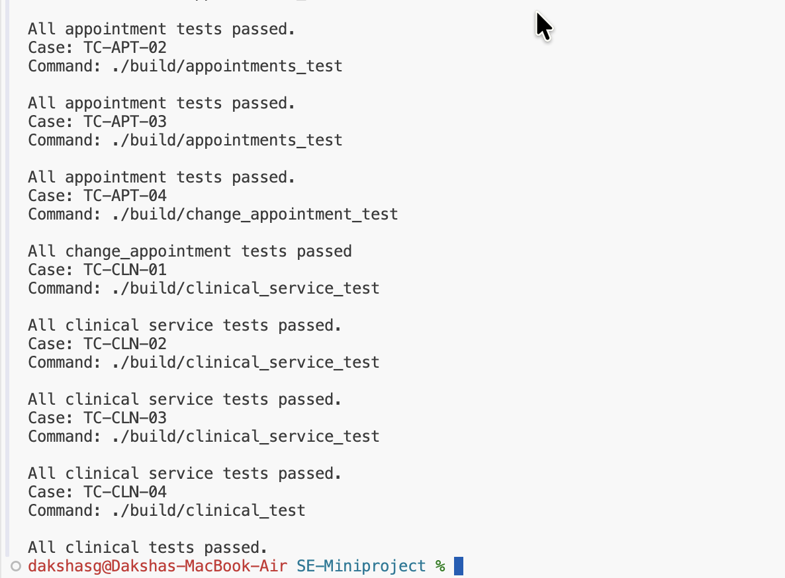

# Daksha SG test evidence

These records support the 20 cases assigned to Daksha SG. The automated
evidence record is dated 2026-11-05; raw terminal output retains its actual capture timestamp on macOS at commit
`bbb6006d4aa46ce1053acff86f79ae858b196f26`.

The 17 functional/security records contain automated component evidence from
CTest and manual demonstration evidence from the Sprint 1 and Sprint 2 videos
listed in `docs/Sprint_Video_links.txt`. The three performance records are
deferred.

### Terminal execution evidence

Shared raw output: [ctest_verbose.log](../automated_tests/ctest_verbose.log)
